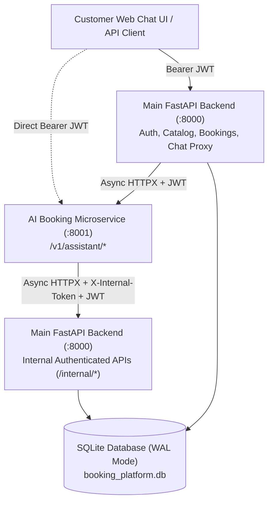

# Rule-Based AI Service Booking Engine

A production-oriented, **100% rule-based conversational service booking engine** built as an independent FastAPI microservice (`ai_booking_service/`) integrated with a core FastAPI + SQLite service-booking backend (`main_backend/`).

> **Zero LLM / Zero External AI APIs / Zero GPU / Zero Docker**
> Natural-language understanding is implemented deterministically using Python normalization, configurable service & location dictionaries, regular expressions, timezone-aware `dateparser` extraction, multi-factor ranking, and a persistent 12-state Finite State Machine (FSM).

---

## Architecture Overview



### Strict Responsibility Separation
- **`main_backend/` (port `8000`)** owns:
  - SQLite database (`SQLAlchemy`, `PRAGMA journal_mode=WAL`, `PRAGMA foreign_keys=ON`, `BEGIN IMMEDIATE` atomic write locks)
  - User accounts & HS256 JWT authentication (PBKDF2-SHA256 salted password hashing)
  - Service catalog, providers, provider-service pricing, availability slots, bookings, and persistent conversation records
  - Concurrency-safe atomic booking creation & cancellation with price revalidation and idempotency protection
  - Authenticated `/internal/*` APIs protected by constant-time `X-Internal-Token` verification
  - Interactive local Web Chat UI at `http://127.0.0.1:8000/`
- **`ai_booking_service/` (port `8001`)** owns:
  - Pure rule-based NLU (normalization, configurable service & location dictionary, date/time parsing with explicit timezone, entity extraction, 13-intent classification)
  - Deterministic ranking engine (`price`, `distance`, `rating`, `earliest`, `best` overall composite score with explanations)
  - Strict 12-state conversational workflow FSM with multi-turn slot filling and reference resolution (`"that one"`, `"the second provider"`, `"the cheapest one"`, `"change it to 4 PM"`)
  - Stateless horizontal scalability — never directly touches the SQLite database

---

## Folder Structure

```text
chatbot/
├── main_backend/
│   ├── app/
│   │   ├── main.py                     # FastAPI entrypoint, lifespan, middleware, static UI
│   │   ├── config.py                   # Typed pydantic-settings configuration
│   │   ├── database.py                 # SQLite WAL engine & BEGIN IMMEDIATE helper
│   │   ├── models.py                   # User, Service, Provider, ProviderService, Slot, Booking, Conversation
│   │   ├── schemas.py                  # Public & internal Pydantic contracts
│   │   ├── security.py                 # PBKDF2 hashing, JWT auth, X-Internal-Token verification
│   │   ├── seed.py                     # Idempotent demo data seeder (Aluva/Kochi providers + 7 days slots)
│   │   ├── api/
│   │   │   ├── auth.py                 # /api/v1/auth/register, /login, /me
│   │   │   ├── public.py               # /api/v1/services, /providers, /bookings, /chat/*
│   │   │   └── internal.py             # /internal/* authenticated service-to-service APIs
│   │   ├── services/
│   │   │   └── booking_service.py      # Search, availability checks, atomic booking & cancellation
│   │   └── static/
│   │       └── index.html              # Interactive local Web Chat UI + FSM & Intent Inspector
│   ├── tests/
│   │   └── test_booking_concurrency.py # Multi-threaded SQLite race, rollback, ownership & auth tests
│   ├── requirements.txt
│   └── .env.example
├── ai_booking_service/
│   ├── app/
│   │   ├── main.py                     # FastAPI entrypoint, lifecycle, safe error handlers
│   │   ├── config.py                   # Service URLs, timezone, TTL, ranking weights, rate limits
│   │   ├── logging_config.py           # Structured JSON logger
│   │   ├── middleware.py               # Correlation IDs (X-Request-ID) & sliding-window rate limiter
│   │   ├── api/
│   │   │   ├── assistant.py            # POST /v1/assistant/message, GET /v1/assistant/conversations/{id}
│   │   │   ├── confirmation.py         # POST /v1/assistant/confirm, POST /v1/assistant/cancel
│   │   │   └── health.py               # GET /health, GET /ready
│   │   ├── core/
│   │   │   ├── service_dictionary.json # Configurable services, aliases & location gazetteer
│   │   │   ├── service_dictionary.py   # Longest-phrase + fuzzy token matcher
│   │   │   ├── date_time_parser.py     # Timezone-aware date/time & ambiguity detector
│   │   │   ├── entity_extractor.py     # Service, location, price, distance, reference, booking ID extractor
│   │   │   ├── intent_parser.py        # 13-intent deterministic classifier
│   │   │   └── ranking_engine.py       # Price, distance, rating, earliest & composite best ranker
│   │   ├── services/
│   │   │   ├── backend_client.py       # Async HTTPX client with typed error mapping
│   │   │   ├── search_coordinator.py   # Provider search + ranking orchestration
│   │   │   ├── booking_coordinator.py  # Availability check, idempotent booking, status & cancel
│   │   │   └── conversation_manager.py # 12-state FSM, slot filling, reference resolution
│   │   ├── repositories/
│   │   │   └── conversation_repository.py
│   │   ├── schemas/
│   │   │   ├── intents.py
│   │   │   ├── requests.py
│   │   │   └── responses.py
│   │   └── utils/
│   │       ├── normalization.py
│   │       └── validators.py
│   ├── tests/
│   │   ├── test_intent_parser.py
│   │   ├── test_entity_extractor.py
│   │   ├── test_search.py
│   │   ├── test_conversation.py
│   │   └── test_booking_flow.py
│   ├── requirements.txt
│   └── .env.example
├── load_tests/
│   └── locustfile.py                   # Locust RPS / latency / booking-contention test plan
├── start_services.ps1                  # One-command local launcher for Windows PowerShell
└── README.md
```

---

## Installation & Local Setup

### 1. Create Virtual Environment & Install Dependencies
```powershell
python -m venv .venv
.\.venv\Scripts\pip.exe install -r main_backend\requirements.txt -r ai_booking_service\requirements.txt
```

### 2. Configure Environment Variables (Optional for Local Dev)
Copy the `.env.example` templates if you want custom secrets or ports:
```powershell
Copy-Item main_backend\.env.example main_backend\.env
Copy-Item ai_booking_service\.env.example ai_booking_service\.env
```

> **Important:** Make sure `INTERNAL_API_TOKEN` matches in both `main_backend/.env` and `ai_booking_service/.env`.

#### Environment Variables Reference

**`main_backend/.env`**
| Variable | Default | Description |
|---|---|---|
| `DATABASE_URL` | `sqlite:///.../booking_platform.db` | SQLAlchemy SQLite database URL |
| `JWT_SECRET_KEY` | dev default | Secret key for signing customer JWT tokens (override in prod) |
| `JWT_ALGORITHM` | `HS256` | JWT signing algorithm |
| `JWT_EXPIRE_MINUTES` | `1440` | Access token lifetime in minutes |
| `INTERNAL_API_TOKEN` | dev default | Shared secret required in `X-Internal-Token` for `/internal/*` |
| `AI_SERVICE_URL` | `http://127.0.0.1:8001` | Base URL of the AI booking microservice |
| `DEFAULT_TIMEZONE` | `Asia/Kolkata` | Explicit timezone for slot generation |
| `AUTO_SEED_DEMO_DATA` | `true` | Auto-seed demo users, services, providers & slots on startup |

**`ai_booking_service/.env`**
| Variable | Default | Description |
|---|---|---|
| `BACKEND_URL` | `http://127.0.0.1:8000` | Base URL of `main_backend` |
| `INTERNAL_API_TOKEN` | dev default | Shared token sent in `X-Internal-Token` |
| `REQUEST_TIMEOUT` | `10.0` | HTTPX timeout in seconds |
| `DEFAULT_TIMEZONE` | `Asia/Kolkata` | Explicit timezone for date/time parsing |
| `CONVERSATION_TTL_MINUTES` | `30` | Conversation expiration TTL |
| `RATE_LIMIT_REQUESTS` | `60` | Max requests per window per client |
| `RATE_LIMIT_WINDOW_SECONDS` | `60` | Sliding window duration in seconds |
| `MAX_MESSAGE_LENGTH` | `1000` | Maximum allowed customer message length |

---

## Running Both Services Locally

### Option A: One-Command PowerShell Launcher
```powershell
.\start_services.ps1
```

### Option B: Run in Two Separate Terminals
Terminal 1 (Main Backend on `:8000`):
```powershell
cd main_backend
..\.venv\Scripts\uvicorn.exe app.main:app --host 127.0.0.1 --port 8000
```

Terminal 2 (AI Booking Microservice on `:8001`):
```powershell
cd ai_booking_service
..\.venv\Scripts\uvicorn.exe app.main:app --host 127.0.0.1 --port 8001
```

### Interactive Endpoints & Demo Accounts
- **Web Chat UI**: `http://127.0.0.1:8000/`
- **Main Backend Swagger UI**: `http://127.0.0.1:8000/docs`
- **AI Microservice Swagger UI**: `http://127.0.0.1:8001/docs`
- **Seeded Demo Accounts**:
  - `alice@example.com` / `Password123!`
  - `bob@example.com` / `Password123!`

---

## API Reference & Example Workflow

### AI Microservice Public APIs (`:8001`)
All `/v1/assistant/*` endpoints require `Authorization: Bearer <customer_jwt>`.
(The same workflow is also proxied by `main_backend` at `/api/v1/chat/*`.)

- `POST /v1/assistant/message` — Process a natural-language customer message
- `POST /v1/assistant/confirm` — Explicitly confirm or decline a pending provider selection
- `POST /v1/assistant/cancel` — Cancel a pending conversation or confirmed booking
- `GET /v1/assistant/conversations/{conversation_id}` — Retrieve user-owned conversation state
- `GET /health` — Basic liveness check
- `GET /ready` — Readiness check verifying `main_backend` dependency health

### Main Backend Internal APIs (`:8000`, `X-Internal-Token` Required)
- `POST /internal/auth/verify`
- `POST /internal/services/search`
- `POST /internal/availability/check`
- `POST /internal/bookings/create`
- `GET /internal/bookings`
- `GET /internal/bookings/{booking_id}`
- `POST /internal/bookings/{booking_id}/cancel`
- `POST /internal/conversations`
- `GET /internal/conversations/{conversation_id}`
- `PUT /internal/conversations/{conversation_id}`

### Example Request & Response
**Request (`POST http://127.0.0.1:8001/v1/assistant/message`)**
```json
{
  "message": "Find the cheapest car wash near Aluva tomorrow at 2 PM"
}
```

**Response**
```json
{
  "success": true,
  "conversation_id": "a6f7f8c0-...",
  "status": "OPTIONS_FOUND",
  "message": "I found 2 available providers for 2026-11-20 at 2:00 PM. The cheapest option is ABC Car Wash for ₹250. Say 'Book that one' or pick a provider (e.g., 'Book the second provider') to proceed.",
  "intent": {
    "type": "FIND_CHEAPEST",
    "confidence": 0.93,
    "service": "car_wash",
    "service_category": "automotive",
    "location": "Aluva",
    "date": "2026-11-20",
    "time": "14:00",
    "sort_by": "price",
    "booking_id": null,
    "ambiguities": []
  },
  "data": {
    "providers": [
      {
        "provider_id": "...",
        "provider_name": "ABC Car Wash",
        "location_name": "Aluva",
        "distance_km": 0.0,
        "rating": 4.6,
        "provider_service_id": "...",
        "price": 250.0,
        "currency": "INR",
        "slot_id": "...",
        "slot_date": "2026-11-20",
        "start_time": "14:00",
        "end_time": "15:00",
        "available": true,
        "ranking_score": 1.0,
        "ranking_explanation": "Ranked #1 by lowest price (INR 250, available)."
      }
    ],
    "sort_by": "price"
  },
  "requires_confirmation": false,
  "missing_fields": [],
  "error_code": null
}
```

---

## Running Automated Tests

```powershell
# Run AI Microservice tests (intent parser, entity extractor, ranking, conversation FSM, booking flows)
.\.venv\Scripts\pytest.exe ai_booking_service\tests -v

# Run Main Backend tests (SQLite WAL BEGIN IMMEDIATE concurrency race, idempotency, rollback, auth, isolation)
.\.venv\Scripts\pytest.exe main_backend\tests -v
```

---

## Load Testing (Locust)

With both services running locally:
```powershell
.\.venv\Scripts\locust.exe -f load_tests\locustfile.py --host http://127.0.0.1:8000 --headless -u 30 -r 5 -t 30s
```
Locust reports RPS, P50/P95/P99 latency, failure rates, and booking contention outcomes under concurrent virtual customers.

---

## Production Security & Scaling Considerations

1. **Secrets**: Replace default `JWT_SECRET_KEY` and `INTERNAL_API_TOKEN` with cryptographically strong random secrets injected via environment variables.
2. **Internal Network Isolation**: Never expose `/internal/*` routes through a public reverse proxy; restrict them to private service-to-service traffic in addition to `X-Internal-Token`.
3. **Zero Trust on Client Input**: Customer identity (`user_id`) is always derived from the verified JWT token, never from request body fields. Prices and slot availability are always revalidated inside the main backend's atomic write transaction before booking confirmation.
4. **Horizontal Scaling**: `ai_booking_service` is completely stateless and can run multiple Uvicorn workers/instances behind a load balancer. When migrating from local SQLite to high-write production scale, switch `DATABASE_URL` to PostgreSQL and swap `BEGIN IMMEDIATE` for `SELECT ... FOR UPDATE` on `availability_slots` with zero API contract changes.
5. **Extending Services**: Add new services, aliases, or cities directly in `ai_booking_service/app/core/service_dictionary.json` without changing parser code.
