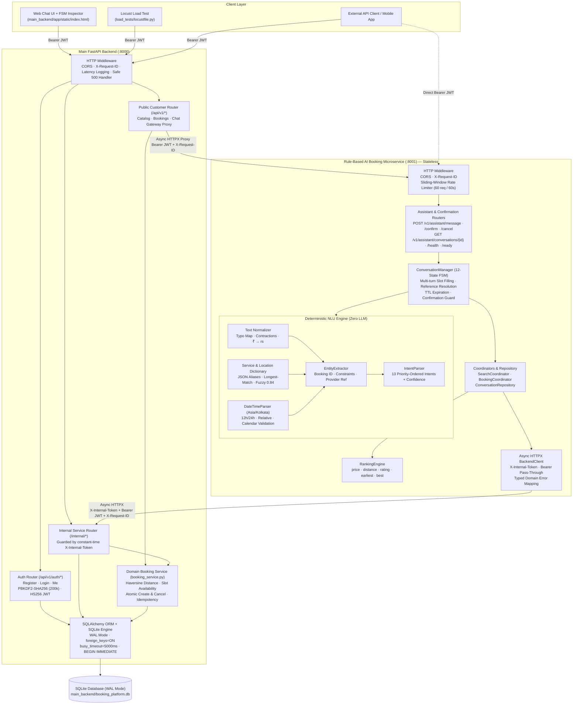
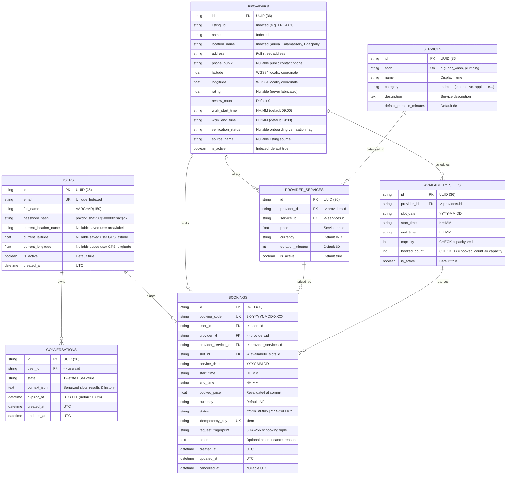
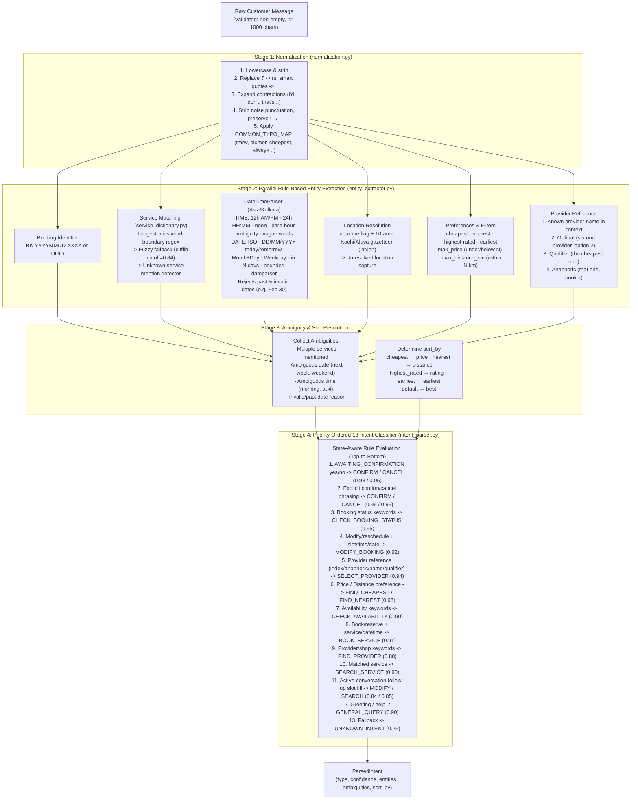
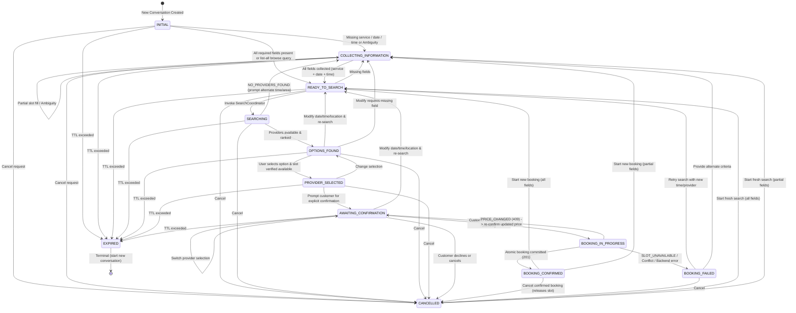
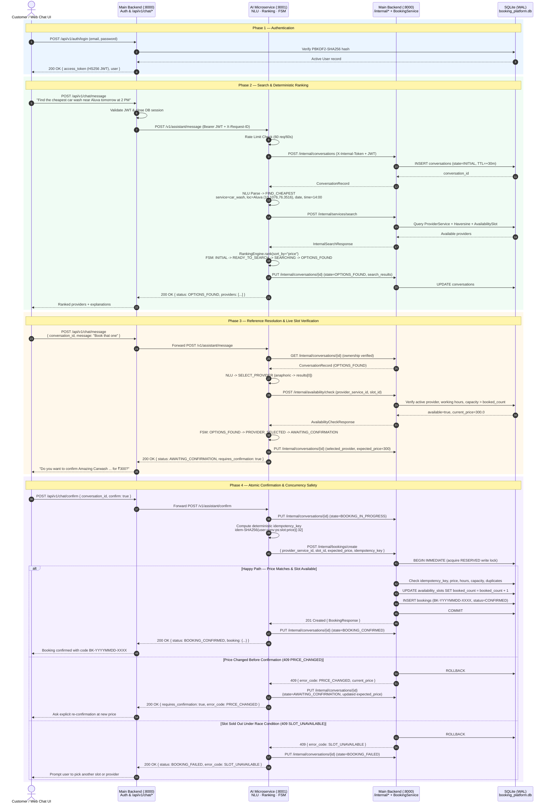
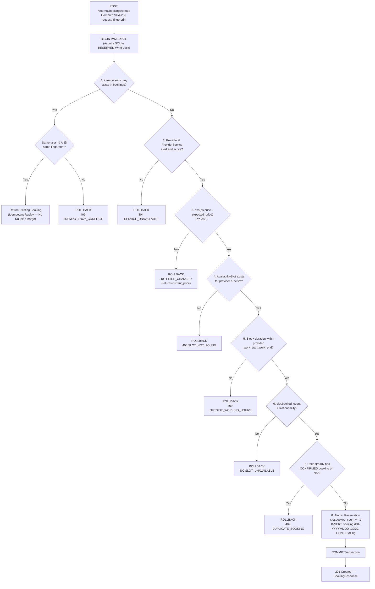
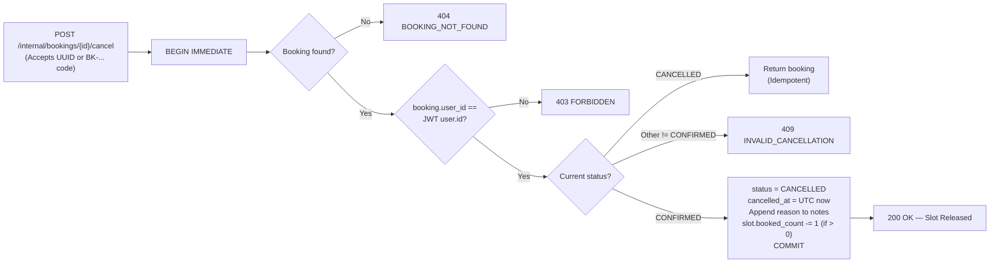
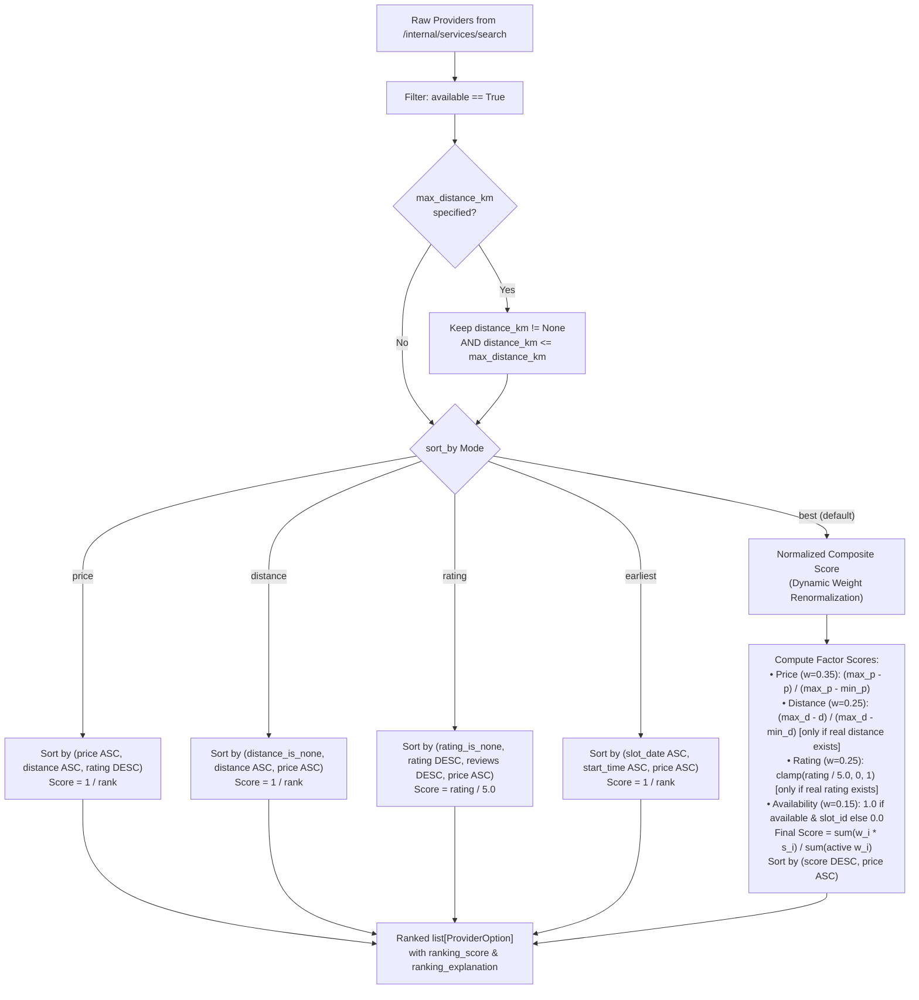
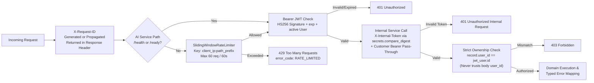

# Rule-Based AI Service Booking Engine

A production-oriented, **100% deterministic, rule-based conversational service booking engine** built as an independent FastAPI microservice (`ai_booking_service/`) integrated with a core FastAPI + SQLite service-booking backend (`main_backend/`).

> **Zero LLM · Zero External AI APIs · Zero GPU · Zero Docker**
> Natural-language understanding is implemented deterministically using Python text normalization, configurable JSON service & location dictionaries, regex & `difflib` fuzzy matching, timezone-aware date/time extraction (`dateparser` + strict calendar validation), deterministic multi-factor ranking, and a persistent 12-state Finite State Machine (FSM).

---

## Table of Contents

1. [System Architecture & Component Topology](#1-system-architecture--component-topology)
2. [Database Schema (ER Diagram)](#2-database-schema-er-diagram)
3. [Deterministic NLU & Intent Classification Pipeline](#3-deterministic-nlu--intent-classification-pipeline)
4. [12-State Conversational Workflow FSM](#4-12-state-conversational-workflow-fsm)
5. [End-to-End Multi-Turn Booking Sequence](#5-end-to-end-multi-turn-booking-sequence)
6. [Concurrency-Safe Atomic Booking & Cancellation](#6-concurrency-safe-atomic-booking--cancellation)
7. [Deterministic Multi-Factor Ranking Engine](#7-deterministic-multi-factor-ranking-engine)
8. [Security, Rate Limiting & Error Propagation](#8-security-rate-limiting--error-propagation)
9. [Folder Structure](#9-folder-structure)
10. [Installation, Configuration & Running Locally](#10-installation-configuration--running-locally)
11. [Complete API Reference & Payloads](#11-complete-api-reference--payloads)
12. [Automated Tests & Locust Load Testing](#12-automated-tests--locust-load-testing)
13. [Production Security & Scaling Guide](#13-production-security--scaling-guide)

---

## 1. System Architecture & Component Topology

The platform enforces **strict service boundary separation**: `ai_booking_service` is completely stateless and never touches SQLite directly—all database reads, conversation persistence, availability verification, and atomic booking writes pass through authenticated `/internal/*` APIs on `main_backend`.



### Strict Responsibility Separation

| Service | Port | Owns | Explicitly Does **Not** Do |
|---|---|---|---|
| **`main_backend/`** | `8000` | SQLite persistence (WAL + `BEGIN IMMEDIATE`), user auth (PBKDF2-SHA256 + HS256 JWT), service/provider catalog, availability slots, atomic booking creation & cancellation, price revalidation, idempotency, conversation record storage, `/internal/*` APIs, local Web Chat UI | No NLU, no regex parsing, no conversational FSM transitions, no composite ranking explanations |
| **`ai_booking_service/`** | `8001` | Deterministic NLU (normalization, dictionary, date/time parser, entity extractor, 13-intent classifier), multi-factor ranking, 12-state conversational FSM, reference resolution, sliding-window rate limiting, correlation IDs | Never opens SQLite, never validates passwords or mints JWTs, never mutates slots directly |

---

## 2. Database Schema (ER Diagram)

All tables are defined in [`main_backend/app/models.py`](main_backend/app/models.py) and managed by SQLAlchemy 2.0 on SQLite with `PRAGMA journal_mode=WAL`, `PRAGMA foreign_keys=ON`, `PRAGMA busy_timeout=5000`, and `PRAGMA synchronous=NORMAL`.



### Key Constraints & Composite Indexes

| Table | Constraint / Index | Purpose |
|---|---|---|
| `provider_services` | `UNIQUE(provider_id, service_id)` · `IX(service_id, price)` | One active offering per provider+service; fast cheapest-service lookup |
| `availability_slots` | `UNIQUE(provider_id, slot_date, start_time)` · `CHECK(capacity >= 1)` · `CHECK(booked_count >= 0 AND booked_count <= capacity)` | Database-level invariant preventing negative counts or overbooking |
| `bookings` | `UNIQUE(booking_code)` · `UNIQUE(idempotency_key)` · `IX(user_id, created_at)` · `IX(slot_id, status)` | Guarantees idempotent retries and fast user/slot duplicate checks |
| `conversations` | `IX(user_id, updated_at)` | Fast lookup of user-owned conversation state |

---

## 3. Deterministic NLU & Intent Classification Pipeline

Every customer message enters a 4-stage deterministic pipeline with **zero stochasticity**, **zero fabricated data**, and explicit ambiguity detection.



### Supported Intents Reference (13 Intents)

| # | Intent | Typical Confidence | Example Customer Utterance |
|---|---|---|---|
| 1 | `CONFIRM_BOOKING` | `0.98` / `0.96` / `0.70` | `"Yes"`, `"Confirm booking"`, `"Go ahead"` |
| 2 | `CANCEL_BOOKING` | `0.95` / `0.70` | `"Cancel"`, `"Cancel booking BK-20261120-AB12"`, `"No"` (while confirming) |
| 3 | `CHECK_BOOKING_STATUS` | `0.95` | `"Show my booking status"`, `"Check my bookings"` |
| 4 | `MODIFY_BOOKING` | `0.92` / `0.84` | `"Change it to 4 PM"`, `"Reschedule to tomorrow"` |
| 5 | `SELECT_PROVIDER` | `0.94` | `"Book that one"`, `"Book the second provider"`, `"Pick the cheapest one"`, `"Sparkle Auto Spa"` |
| 6 | `FIND_CHEAPEST` | `0.93` | `"Find the cheapest car wash near Aluva tomorrow at 2 PM"` |
| 7 | `FIND_NEAREST` | `0.93` | `"Find the nearest plumber in Kochi tomorrow at 10 AM"` |
| 8 | `CHECK_AVAILABILITY` | `0.90` | `"Check availability for AC repair tomorrow at 11 AM"` |
| 9 | `BOOK_SERVICE` | `0.91` | `"Book an electrician near Kakkanad tomorrow at 4 PM"` |
| 10 | `FIND_PROVIDER` | `0.88` | `"List all the car wash centres"`, `"Find providers near Edappally"` |
| 11 | `SEARCH_SERVICE` | `0.90` / `0.85` / `0.60` | `"List all the plumbers near me"`, `"I need home cleaning"`, `"Tomorrow at 2 PM"` (slot-filling follow-up) |
| 12 | `GENERAL_QUERY` | `0.90` | `"Hi"`, `"Help"`, `"What services do you support?"` |
| 13 | `UNKNOWN_INTENT` | `0.25` | Unrecognized non-booking utterances |

### Configurable Dictionary (`service_dictionary.json`)

- **6 Services**: `car_wash` (automotive, 60m), `plumbing` (home_maintenance, 60m), `ac_repair` (appliance, 60m), `electrical` (home_maintenance, 60m), `home_cleaning` (cleaning, 120m), `appliance_repair` (appliance, 60m) — each with rich multi-word aliases.
- **10 Kochi/Aluva Locations with Coordinates**: `Aluva` (10.1076, 76.3516), `Kochi` (9.9312, 76.2673), `Ernakulam` (9.9816, 76.2999), `Kakkanad` (10.0159, 76.3419), `Edappally` (10.0261, 76.3125), `Kalamassery` (10.0553, 76.3219), `Kaloor` (9.9942, 76.2921), `Vyttila` (9.9685, 76.3182), `Fort Kochi` (9.9658, 76.2421), `Tripunithura` (9.9487, 76.3464).

---

## 4. 12-State Conversational Workflow FSM

`ConversationManager` enforces strict transitions via `ALLOWED_TRANSITIONS` in [`ai_booking_service/app/services/conversation_manager.py`](ai_booking_service/app/services/conversation_manager.py). Invalid transitions raise `InvalidStateTransitionError`, and every conversation is persisted in SQLite with a sliding TTL (`CONVERSATION_TTL_MINUTES = 30`).



### Persistent `context_json` Structure

Stored inside `conversations.context_json` in `main_backend`:
- **Slots & Filters**: `service`, `service_display`, `service_category`, `location`, `latitude`, `longitude`, `date`, `time`, `sort_by`, `max_price`, `max_distance_km`
- **Search & Selection**: `search_results` (ranked provider snapshots), `selected_provider` (verified `provider_service_id`, `slot_id`, `expected_price`, `currency`)
- **Booking Snapshot**: `confirmed_booking_id`, `confirmed_booking_code`, `confirmed_booking`
- **Audit Window**: `extracted_intent`, `history` (last 20 customer/assistant turns)

---

## 5. End-to-End Multi-Turn Booking Sequence

The following sequence diagram traces a full authenticated booking session—including live availability checks, deterministic idempotency, atomic slot reservation, and conflict handling (`PRICE_CHANGED`, `SLOT_UNAVAILABLE`, and idempotent replay).



---

## 6. Concurrency-Safe Atomic Booking & Cancellation

SQLite defaults to deferred read transactions that can cause write deadlocks or double-booking races under concurrent requests. [`main_backend/app/database.py`](main_backend/app/database.py) solves this with `isolation_level=None` and `immediate_transaction()`, which executes **`BEGIN IMMEDIATE`** to acquire SQLite's `RESERVED` write lock at the very start of the transaction (SQLite's equivalent of PostgreSQL's `SELECT ... FOR UPDATE`).



### Atomic Cancellation Flow (`POST /internal/bookings/{booking_id}/cancel`)



---

## 7. Deterministic Multi-Factor Ranking Engine

[`ai_booking_service/app/core/ranking_engine.py`](ai_booking_service/app/core/ranking_engine.py) filters out unavailable providers, optionally applies `max_distance_km`, and produces deterministic scores plus human-readable `ranking_explanation` strings. **Missing ratings or distances are never fabricated.**



### Composite Ranking Weights (Configurable via `.env`)

| Factor | Env Variable | Default Weight | Normalization Formula | Missing Data Behavior |
|---|---|---|---|---|
| **Price** | `RANK_WEIGHT_PRICE` | `0.35` | `(max_p - price) / (max_p - min_p)` (`1.0` if equal) | Always present |
| **Distance** | `RANK_WEIGHT_DISTANCE` | `0.25` | `(max_d - dist) / (max_d - min_d)` (`1.0` if equal) | Excluded from numerator & denominator (`active_weight`) |
| **Rating** | `RANK_WEIGHT_RATING` | `0.25` | `clamp(rating / 5.0, 0.0, 1.0)` | Excluded from numerator & denominator (e.g., unrated listings like `Electro Tech Home Appliance Services` with `rating=None`) |
| **Availability** | `RANK_WEIGHT_AVAILABILITY` | `0.15` | `1.0` if `available && slot_id` else `0.0` | Always evaluated |

---

## 8. Security, Rate Limiting & Error Propagation



### Security Highlights
- **Zero Trust on Client Payloads**: `user_id` is always derived server-side from the verified JWT `sub` claim—never accepted from request JSON.
- **Password Hashing**: Salted PBKDF2-SHA256 with `200,000` iterations, `16`-byte random salt, and constant-time verification (`hmac.compare_digest`).
- **Service-to-Service Auth**: All `/internal/*` endpoints enforce constant-time `secrets.compare_digest` verification of `X-Internal-Token`.
- **Safe Logging**: Neither `Authorization` headers nor `X-Internal-Token` values are ever logged; structured JSON logs include `request_id`, `method`, `path`, `status_code`, and `duration_ms`.
- **Typed Backend Error Mapping (`backend_client.py`)**: Network timeouts (`504 BACKEND_TIMEOUT`), connection failures (`503 BACKEND_UNAVAILABLE`), auth/ownership errors (`401`/`403`/`404`), and booking conflicts (`409 PRICE_CHANGED`, `SLOT_UNAVAILABLE`, `BOOKING_CONFLICT`) are mapped to clean domain responses without leaking stack traces.

---

## 9. Folder Structure

```text
agentic/
├── main_backend/
│   ├── app/
│   │   ├── main.py                     # FastAPI entrypoint, lifespan auto-seeding, CORS, X-Request-ID, UI
│   │   ├── config.py                   # Typed pydantic-settings configuration
│   │   ├── database.py                 # SQLite WAL engine, PRAGMAs & BEGIN IMMEDIATE context manager
│   │   ├── models.py                   # 7 SQLAlchemy ORM models with CHECK & UNIQUE constraints
│   │   ├── schemas.py                  # Public & internal Pydantic v2 contracts
│   │   ├── security.py                 # PBKDF2-SHA256 (200k), HS256 JWT, constant-time X-Internal-Token
│   │   ├── seed.py                     # Idempotent seeder (2 demo users, 6 services, 33 Ernakulam/Kochi providers, 44 offerings, 7d slots)
│   │   ├── api/
│   │   │   ├── auth.py                 # /api/v1/auth/register, /login, /me
│   │   │   ├── public.py               # /api/v1/services, /providers, /bookings, /chat/* gateway proxy
│   │   │   └── internal.py             # /internal/* service-to-service APIs (10 endpoints)
│   │   ├── services/
│   │   │   └── booking_service.py      # Haversine search, availability check, atomic create & cancel
│   │   └── static/
│   │       └── index.html              # Interactive Web Chat UI, User GPS/Area Location Panel, Route/Directions & FSM Inspector
│   ├── tests/
│   │   ├── conftest.py
│   │   └── test_booking_concurrency.py # Multi-threaded SQLite race, rollback, idempotency, ownership & auth
│   ├── requirements.txt
│   └── .env.example
├── ai_booking_service/
│   ├── app/
│   │   ├── main.py                     # FastAPI app factory, lifespan DI, safe exception handlers
│   │   ├── config.py                   # URLs, timezone, TTL, rate limits, composite ranking weights
│   │   ├── logging_config.py           # Structured JSON logger
│   │   ├── middleware.py               # X-Request-ID correlation & SlidingWindowRateLimiter
│   │   ├── api/
│   │   │   ├── assistant.py            # POST /v1/assistant/message, GET /v1/assistant/conversations/{id}
│   │   │   ├── confirmation.py         # POST /v1/assistant/confirm, POST /v1/assistant/cancel
│   │   │   └── health.py               # GET /health, GET /ready
│   │   ├── core/
│   │   │   ├── service_dictionary.json # Configurable 6 services, aliases & 10-location gazetteer
│   │   │   ├── service_dictionary.py   # Longest-phrase regex + difflib fuzzy token matcher (0.84)
│   │   │   ├── date_time_parser.py     # Timezone-aware parser, calendar validator & ambiguity detector
│   │   │   ├── entity_extractor.py     # Service, location, price, distance, ref & booking ID extractor
│   │   │   ├── intent_parser.py        # 13-intent priority-ordered deterministic classifier
│   │   │   └── ranking_engine.py       # Price, distance, rating, earliest & normalized composite ranker
│   │   ├── services/
│   │   │   ├── backend_client.py       # Async HTTPX client with typed error mapping
│   │   │   ├── search_coordinator.py   # Backend search + RankingEngine orchestration
│   │   │   ├── booking_coordinator.py  # Availability verification, SHA-256 idempotency, status & cancel
│   │   │   └── conversation_manager.py # 12-state FSM, multi-turn slot filling & reference resolution
│   │   ├── repositories/
│   │   │   └── conversation_repository.py
│   │   ├── schemas/
│   │   │   ├── intents.py
│   │   │   ├── requests.py
│   │   │   └── responses.py
│   │   └── utils/
│   │       ├── normalization.py        # Typo map, contractions & currency normalization
│   │       └── validators.py           # Length validation & booking code/UUID regex extraction
│   ├── tests/
│   │   ├── conftest.py
│   │   ├── test_intent_parser.py
│   │   ├── test_entity_extractor.py
│   │   ├── test_search.py
│   │   ├── test_conversation.py
│   │   └── test_booking_flow.py
│   ├── requirements.txt
│   └── .env.example
├── load_tests/
│   └── locustfile.py                   # Locust RPS, latency & slot-contention load test
├── start_services.ps1                  # One-command local launcher with startup health checks
└── README.md
```

---

## 10. Installation, Configuration & Running Locally

### 1. Create Virtual Environment & Install Dependencies
```powershell
python -m venv .venv
.\.venv\Scripts\pip.exe install -r main_backend\requirements.txt -r ai_booking_service\requirements.txt
```

### 2. Configure Environment Variables (Optional for Local Dev)
```powershell
Copy-Item main_backend\.env.example main_backend\.env
Copy-Item ai_booking_service\.env.example ai_booking_service\.env
```

> **Important:** `INTERNAL_API_TOKEN` must match in both `main_backend/.env` and `ai_booking_service/.env`.

#### Environment Variables Reference

**`main_backend/.env`**
| Variable | Default | Description |
|---|---|---|
| `DATABASE_URL` | `sqlite:///.../booking_platform.db` | SQLAlchemy database URL |
| `JWT_SECRET_KEY` | dev default | Secret key for signing HS256 customer JWTs (override in prod) |
| `JWT_ALGORITHM` | `HS256` | JWT signing algorithm |
| `JWT_EXPIRE_MINUTES` | `1440` | Access token lifetime in minutes (24 hours) |
| `INTERNAL_API_TOKEN` | dev default | Shared secret verified via `X-Internal-Token` on `/internal/*` |
| `AI_SERVICE_URL` | `http://127.0.0.1:8001` | Base URL of `ai_booking_service` |
| `AI_REQUEST_TIMEOUT` | `15.0` | Proxy timeout in seconds for forwarding to `ai_booking_service` |
| `DEFAULT_TIMEZONE` | `Asia/Kolkata` | Explicit IANA timezone for slot generation |
| `AUTO_SEED_DEMO_DATA` | `true` | Idempotently seed demo users, services, providers & 7-day slots |
| `LOG_LEVEL` | `INFO` | Logging verbosity |

**`ai_booking_service/.env`**
| Variable | Default | Description |
|---|---|---|
| `BACKEND_URL` | `http://127.0.0.1:8000` | Base URL of `main_backend` |
| `INTERNAL_API_TOKEN` | dev default | Shared token sent in `X-Internal-Token` |
| `REQUEST_TIMEOUT` | `10.0` | HTTPX request timeout to `main_backend` (seconds) |
| `DEFAULT_TIMEZONE` | `Asia/Kolkata` | Explicit IANA timezone for date/time parsing |
| `CONVERSATION_TTL_MINUTES` | `30` | Sliding expiration window per conversation |
| `RATE_LIMIT_REQUESTS` | `60` | Max requests per sliding window per client IP + prefix |
| `RATE_LIMIT_WINDOW_SECONDS` | `60` | Sliding window duration in seconds |
| `MAX_MESSAGE_LENGTH` | `1000` | Max customer message character length |
| `MAX_SEARCH_RESULTS` | `10` | Max ranked providers returned per search |
| `RANK_WEIGHT_PRICE` | `0.35` | Composite `"best"` ranking weight for price |
| `RANK_WEIGHT_DISTANCE` | `0.25` | Composite `"best"` ranking weight for distance |
| `RANK_WEIGHT_RATING` | `0.25` | Composite `"best"` ranking weight for customer rating |
| `RANK_WEIGHT_AVAILABILITY` | `0.15` | Composite `"best"` ranking weight for availability |
| `LOG_LEVEL` | `INFO` | Structured JSON logging level |

### 3. Run Both Services Locally

**Option A: One-Command PowerShell Launcher (Recommended)**
Starts both services via `.venv\Scripts\python.exe -m uvicorn`, checks startup exit codes after 2 seconds, monitors both processes, and cleanly terminates both on `Ctrl+C`:
```powershell
.\start_services.ps1
```

**Option B: Two Separate Terminals**
```powershell
# Terminal 1 — Main Backend (:8000)
cd main_backend
..\.venv\Scripts\python.exe -m uvicorn app.main:app --host 127.0.0.1 --port 8000

# Terminal 2 — AI Booking Microservice (:8001)
cd ai_booking_service
..\.venv\Scripts\python.exe -m uvicorn app.main:app --host 127.0.0.1 --port 8001
```

### Interactive Endpoints & Seeded Demo Data
- **Web Chat UI & FSM Inspector**: `http://127.0.0.1:8000/`
- **Main Backend Swagger UI**: `http://127.0.0.1:8000/docs`
- **AI Microservice Swagger UI**: `http://127.0.0.1:8001/docs`
- **Seeded Demo Accounts**:
  - `alice@example.com` / `Password123!`
  - `bob@example.com` / `Password123!`
- **Seeded Catalog**: 6 services, **33 Ernakulam/Kochi/Aluva-area providers** (**44 service offerings** — including unrated listings with `rating=None` to verify zero rating fabrication, plus `listing_id`, `phone_public`, `verification_status`, and `source_name`), and 8 daily 1-hour slots (`09:00`–`12:00`, `14:00`–`17:00`, capacity `1`) for `today` through `today + 7 days` (**2,112 total slots**).
  - Default INR base prices by category: Car Wash (`₹300`, 60m), Electrical Repair (`₹300`, 60m), Plumbing (`₹350`, 60m), Appliance Repair (`₹450`, 60m), AC Repair (`₹500`, 60m), Home Cleaning (`₹750`, 120m).

---

## 11. Complete API Reference & Payloads

### Main Backend Public APIs (`:8000`)

| Method | Endpoint | Auth | Description |
|---|---|---|---|
| `GET` | `/` | Public | Serves interactive Web Chat UI (`index.html`) |
| `GET` | `/health` · `/ready` | Public | Liveness probe & SQLite `SELECT 1` readiness check |
| `POST` | `/api/v1/auth/register` | Public | Register account (returns HS256 JWT + user) |
| `POST` | `/api/v1/auth/login` | Public | Authenticate email/password (returns HS256 JWT) |
| `GET` | `/api/v1/auth/me` | Bearer JWT | Return authenticated customer profile (including saved current location) |
| `PUT` | `/api/v1/auth/location` | Bearer JWT | Save or clear the customer's current GPS coordinates & area label |
| `GET` | `/api/v1/services` | Public | List service catalog |
| `GET` | `/api/v1/providers` | Public | List active providers |
| `GET` | `/api/v1/bookings` | Bearer JWT | List current customer's bookings |
| `POST` | `/api/v1/chat/message` | Bearer JWT | Proxy to `ai_booking_service` `/v1/assistant/message` |
| `POST` | `/api/v1/chat/confirm` | Bearer JWT | Proxy to `ai_booking_service` `/v1/assistant/confirm` |
| `POST` | `/api/v1/chat/cancel` | Bearer JWT | Proxy to `ai_booking_service` `/v1/assistant/cancel` |
| `GET` | `/api/v1/chat/conversations/{id}` | Bearer JWT | Proxy to `ai_booking_service` `/v1/assistant/conversations/{id}` |

### AI Booking Microservice APIs (`:8001`)

| Method | Endpoint | Auth | Description |
|---|---|---|---|
| `POST` | `/v1/assistant/message` | Bearer JWT | Process natural-language message through NLU + FSM |
| `POST` | `/v1/assistant/confirm` | Bearer JWT | Explicitly confirm (`true`) or decline (`false`) pending selection |
| `POST` | `/v1/assistant/cancel` | Bearer JWT | Cancel pending conversation or confirmed booking |
| `GET` | `/v1/assistant/conversations/{id}` | Bearer JWT | Fetch user-owned conversation state & context |
| `GET` | `/health` · `/ready` | Public | Liveness & downstream `main_backend` readiness probe |

### Main Backend Internal APIs (`:8000/internal/*`, `X-Internal-Token` Required)

| Method | Endpoint | Customer JWT | Description |
|---|---|---|---|
| `POST` | `/internal/auth/verify` | Required | Verify customer Bearer token & return user identity |
| `POST` | `/internal/services/search` | Not required | Filter providers by service, location/Haversine, price & slot |
| `POST` | `/internal/availability/check` | Not required | Live check of active provider, working hours, price & remaining capacity |
| `POST` | `/internal/bookings/create` | Required | Concurrency-safe `BEGIN IMMEDIATE` atomic booking creation |
| `GET` | `/internal/bookings` | Required | List user's recent bookings |
| `GET` | `/internal/bookings/{booking_id}` | Required | Fetch booking by UUID or `BK-...` code (ownership enforced) |
| `POST` | `/internal/bookings/{booking_id}/cancel` | Required | Atomic cancellation & slot capacity release |
| `POST` | `/internal/conversations` | Required | Create persistent conversation record with TTL |
| `GET` | `/internal/conversations/{id}` | Required | Fetch conversation record (ownership enforced) |
| `PUT` | `/internal/conversations/{id}` | Required | Update FSM state, `context_json`, and optional sliding TTL |

### Example Request & Response (`POST /v1/assistant/message`)

**Request** (optionally includes the user's live GPS/area coordinates to measure distance to every provider)
```json
{
  "message": "Find the cheapest car wash near Aluva tomorrow at 2 PM",
  "latitude": 10.0553,
  "longitude": 76.3219,
  "location_label": "Kalamassery"
}
```

**Response**
```json
{
  "success": true,
  "conversation_id": "a6f7f8c0-...",
  "status": "OPTIONS_FOUND",
  "message": "I found 3 available providers for 2026-11-20 at 2:00 PM. The cheapest option is Topnotch Car Wash and Detailing (4.32 km from Kalamassery) for ₹300. Say 'Book that one' or pick a provider (e.g., 'Book the second provider') to proceed.",
  "intent": {
    "type": "FIND_CHEAPEST",
    "confidence": 0.93,
    "service": "car_wash",
    "service_category": "automotive",
    "location": "Aluva",
    "date": "2026-11-20",
    "time": "14:00",
    "sort_by": "price",
    "booking_id": null,
    "ambiguities": []
  },
  "data": {
    "user_location": {
      "label": "Kalamassery",
      "latitude": 10.0553,
      "longitude": 76.3219
    },
    "providers": [
      {
        "provider_id": "...",
        "listing_id": "ERK-002",
        "provider_name": "Topnotch Car Wash and Detailing",
        "location_name": "Aluva",
        "address": "Metro Pillar 100, NH47, Companypady, Choornikkara, Aluva, Kerala 683106",
        "phone_public": "+91 97479 99804",
        "latitude": 10.0882,
        "longitude": 76.3428,
        "distance_km": 4.32,
        "rating": 4.9,
        "review_count": 18,
        "verification_status": "public_listing_found_verify_before_onboarding",
        "source_name": "Google business listing",
        "provider_service_id": "...",
        "price": 300.0,
        "currency": "INR",
        "slot_id": "...",
        "slot_date": "2026-11-20",
        "start_time": "14:00",
        "end_time": "15:00",
        "available": true,
        "ranking_score": 1.0,
        "ranking_explanation": "Ranked #1 by lowest price (INR 300, available)."
      }
    ],
    "sort_by": "price"
  },
  "requires_confirmation": false,
  "missing_fields": [],
  "error_code": null
}
```

### Standard Error Codes

| Error Code | Source | Meaning |
|---|---|---|
| `INVALID_INPUT` | AI Service | Empty message or length > `MAX_MESSAGE_LENGTH` |
| `RATE_LIMITED` | AI Service (`429`) | Client exceeded sliding-window rate limit |
| `CONVERSATION_EXPIRED` | AI Service | Conversation exceeded `CONVERSATION_TTL_MINUTES` |
| `INVALID_DATE` / `AMBIGUOUS_DATETIME` | NLU | Past/invalid date (e.g., `2026-02-30`) or vague phrase (`morning`, `next week`) |
| `AMBIGUOUS_SERVICE` / `UNKNOWN_SERVICE` | NLU | Multiple services in one turn or unsupported service requested |
| `NO_PROVIDERS_FOUND` | Search | No active available provider matched criteria |
| `PRICE_CHANGED` | Main Backend (`409`) | Provider price changed since selection; triggers explicit re-confirmation |
| `SLOT_UNAVAILABLE` / `OUTSIDE_WORKING_HOURS` | Main Backend (`409`) | Slot filled concurrently or outside provider working hours |
| `DUPLICATE_BOOKING` / `IDEMPOTENCY_CONFLICT` | Main Backend (`409`) | Duplicate active slot booking or mismatched idempotency fingerprint |
| `BACKEND_TIMEOUT` / `BACKEND_UNAVAILABLE` | HTTPX Client (`504`/`503`) | Downstream `main_backend` unreachable or timed out |

---

## 12. Automated Tests & Locust Load Testing

### Pytest Suites
```powershell
# 1. AI Microservice unit & integration tests (44 tests)
#    Covers: 13 intents, list-all browse queries, entity extraction, typos, date ambiguities, ranking, 12-state FSM, user GPS location, end-to-end booking flows
.\.venv\Scripts\python.exe -m pytest ai_booking_service\tests -v

# 2. Main Backend concurrency, security & persistence tests (6 tests)
#    Covers: multi-threaded SQLite BEGIN IMMEDIATE race conditions, idempotency replay/conflict,
#            price change rollback, cancellation slot release, user current location persistence & distance search, JWT & X-Internal-Token enforcement
.\.venv\Scripts\python.exe -m pytest main_backend\tests -v
```

### Locust Load Testing
[`load_tests/locustfile.py`](load_tests/locustfile.py) registers unique virtual customers and runs a weighted traffic mix:
- **Weight 4**: Single-turn search & ranking queries across services and areas
- **Weight 2**: Multi-turn search → select (`"Book that one"`) → confirm contention on the same popular slot (verifying `SLOT_UNAVAILABLE` conflicts are handled safely with zero 500s)
- **Weight 1**: Booking status lookups

```powershell
# Headless benchmark (30 concurrent users, spawn rate 5/s, 30s duration)
.\.venv\Scripts\locust.exe -f load_tests\locustfile.py --host http://127.0.0.1:8000 --headless -u 30 -r 5 -t 30s

# Or launch the Locust Web UI on http://localhost:8089
.\.venv\Scripts\locust.exe -f load_tests\locustfile.py --host http://127.0.0.1:8000
```

---

## 13. Production Security & Scaling Guide

1. **Strong Secrets Management**: Replace default `JWT_SECRET_KEY` and `INTERNAL_API_TOKEN` with cryptographically random secrets injected from a secret manager or environment variables.
2. **Private Network Isolation**: Never expose `/internal/*` on public ingress/reverse proxies; restrict access to private mesh/VPC traffic alongside `X-Internal-Token`.
3. **Distributed Rate Limiting**: Replace the in-memory `SlidingWindowRateLimiter` with a Redis-backed limiter when scaling `ai_booking_service` horizontally across multiple pods/workers.
4. **Horizontal Scaling & PostgreSQL Migration**:
   - `ai_booking_service` is completely stateless and scales horizontally behind any HTTP load balancer.
   - To scale writes beyond local SQLite, point `DATABASE_URL` to PostgreSQL and swap SQLite's `BEGIN IMMEDIATE` in [`main_backend/app/database.py`](main_backend/app/database.py) for row-level `SELECT ... FOR UPDATE` on `availability_slots`—with **zero API contract changes**.
5. **Extending Services & Locations**: Add new services, aliases, or cities directly in [`ai_booking_service/app/core/service_dictionary.json`](ai_booking_service/app/core/service_dictionary.json) without touching parser code.
